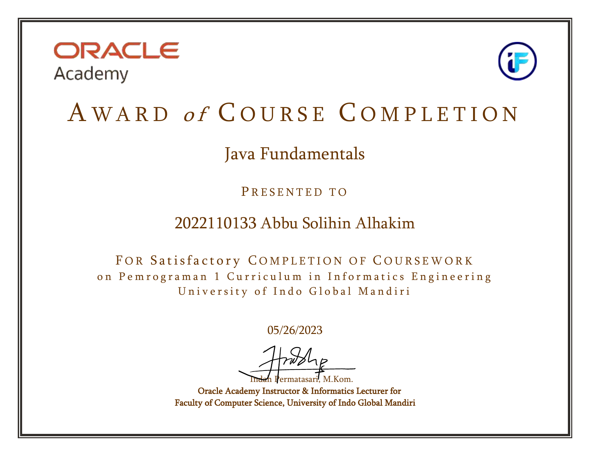
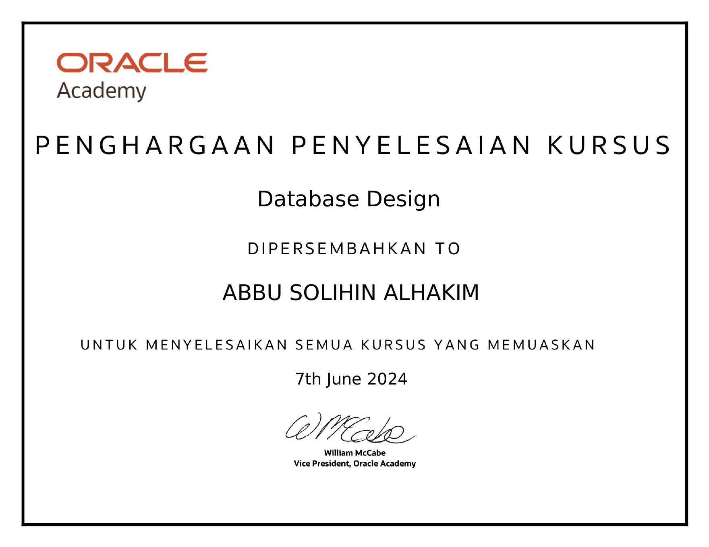

# Academic Course Completion Certificates

This repository contains course completion certificates earned during my Informatics Engineering studies, covering foundational Java programming and database design.

## Java Fundamentals

  

### Overview

Completed **Java Fundamentals** coursework as part of the **Pemrograman 1** curriculum in the Informatics Engineering program at **Universitas Indo Global Mandiri**. The coursework provided a foundation in Java programming.

- **Issuer:** Oracle Academy
- **Course:** Java Fundamentals
- **Date of Completion:** May 26, 2023
- **Academic Context:** Pemrograman 1 — Informatics Engineering

[View the original PDF certificate](./java-fundamentals-certificate.pdf)

---

## Database Design

  

### Overview

Completed the **Database Design** course during my university studies. The learning activities covered foundational relational database design, including **Entity Relationship Diagrams (ERD)** and **SQL queries**, with hands-on practice using **MySQL**.

- **Issuer:** Oracle Academy
- **Course:** Database Design
- **Date of Completion:** June 7, 2024
- **Learning Topics:** ERD modeling, SQL queries, relational database design
- **Database Tool:** MySQL

[View the original PDF certificate](./database-design-certificate.pdf)

---

These certificates document foundational learning completed during academic studies.
